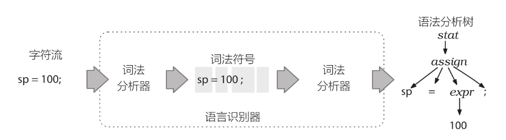
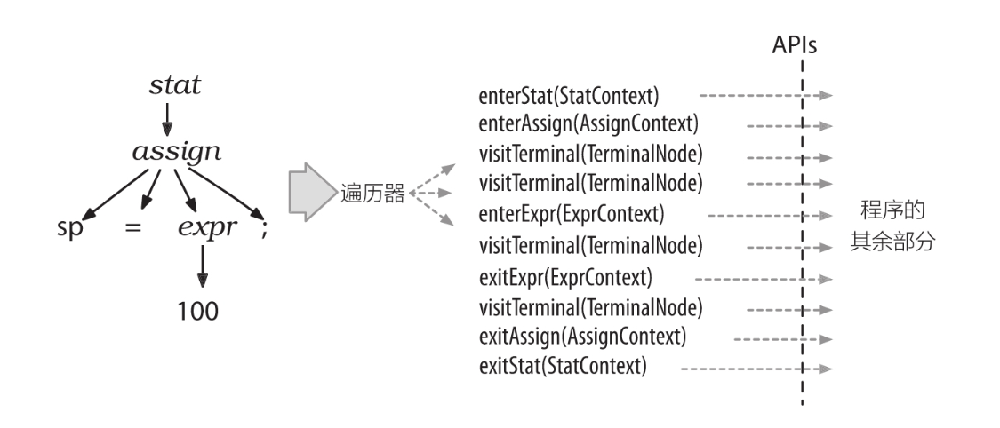
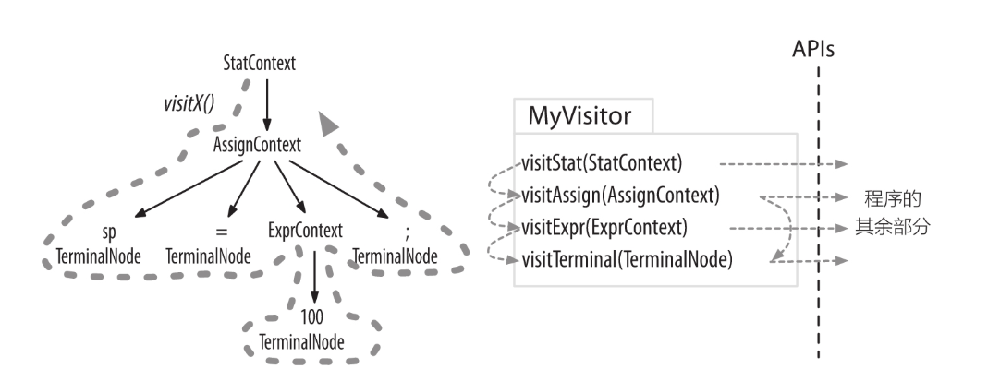

# antlr4 权威指南

**词法分析**（英语：lexical analysis）是计算机科学中将字符序列转换为标记（token）序列的过程。进行词法分析的程序或者函数叫作词法分析器（lexical analyzer，简称lexer），也叫扫描器（scanner）。词法分析器一般以函数的形式存在，供语法分析器调用。

这里的标记是一个字串，是构成源代码的最小单位。从输入字符流中生成标记的过程叫作标记化（tokenization），在这个过程中，词法分析器还会对标记进行分类.

词法分析完成后，需要将这些单词或符号，根据语法规则，识别为有意义的语句，这个过程称为语法分析。

**语法分析**（英语：syntactic analysis，也叫 parsing）是根据某种给定的形式文法对由单词序列（如英语单词序列）构成的输入文本进行分析并确定其语法结构的一种过程。

语法分析器（parser）它的作用是进行语法检查、并构建由输入的单词组成的数据结构（一般是语法分析树、抽象语法树等层次化的数据结构）。语法分析器通常使用一个独立的词法分析器从输入字符流中分离出一个个的“单词”，并将单词流作为其输入。

```
lexer & parser ??
```

**生成对应语言的文件**：

`antlr4  -Dlanguage=Python3 -visitor Hello.g4`

**Test Rig 的使用**

```
pygrun -h
Usage: pygrun [options] Grammar_Name Start_Rule

Options:
  -h, --help         show this help message and exit
  -t, --tree         Print AST tree
  -k, --tokens       Show Tokens
  -s, --sll          Show SLL
  -d, --diagnostics  Enable diagnostics error listener
  -a, --trace        Enable Trace

pygrun -k Hello r
hello parrt
^Z
[@0,0:4='hello',<1>,1:0]
[@1,6:10='parrt',<2>,1:6]
[@2,12:11='<EOF>',<-1>,2:0]

pygrun -t Hello r
hello parrt
^Z
(r hello parrt)
```

## 语法模式

- 序列模式，即一系列元素
- 选择模式，在多个可选方案中做出选择
- 词法符号依赖，一个词法符号需要和某处的另外一个词法符号配对
- 嵌套结构，一种自相似的语言结构。

### 序列模式

它是一个任意长的，可能为空的序列，其中的元素可以是词法符号或者子规则。序列模式的例子包括变量声明和整数序列等等，比如：

```text
'[' INT+ ']'  //Matlab的整数向量
```

- 带终止符的序列模式

  它是一个任意长的，可能为空的序列，该序列由一个词法符号分隔开，通常是分号或换行符，其中的元素可以是词法符号或者子规则。这样的例子包括类C语言的语句集合和一些用换行符来分隔的数据格式。

  ```
  （statement ';')*  //java的语句集合
  （row '\n')* //多行数据
  ```

- 带分隔符的序列模式

  它是一个任意长的，可能为空的序列，该序列由一个词法符号分隔开，通常是逗号，分号或句号，其中的元素可以是词法符号或者子规则。这样的例子包括函数定义的参数列表，函数调用时传递的参数列表、某些语句之间有分隔符却无终止符的编程语言。

  ```
  exprList: expr(',' expr)* 
  ```

### 选择模式

它是一组备选分支的集合。使用｜来分隔同一个语言规则的若干备选分支。这样的例子包括不同种类的类型、语句、表达式或者XML标签。比如下面这个字段定义表达式：

```
field：INT | STRING；  //允许子段中出现整数或者字符串
```

### 词法符号依赖模式

一个词法符号需要和一个或多个后续词法符号匹配。这样的例子包括配对的圆括号，花括号，方括号和尖括号。

此时，如果我们在一个语句中看到一个符号，那么就必须在语句中找到另一个配对的符号。为表达出这种语意，在语法中，使用一个序列来指明所有配对的符号，通常这些符号会把其他元素分组或包裹起来。

比如，对于一个整数向量，可以用这种方式表示：

```antlr
vector: '[' INT+ ']' ;  //[1], [1,2], [1,2,3],...
```

### 嵌套模式

它是一种子相似的语言结构。这样的例子包括表达式，Java的内部类、嵌套的代码块以及嵌套的Python函数定义。

比如嵌套数组表达式定义：

```antlr
expr: ID '[' expr ']'  //a[1],a[b[1]],a[(2*b[1])]
    | '(' expr ')'  //(1),(a[1]),(((1))),(2*a[1])
    | INT
    ;
```

## 开始使用

### 2.1 ANTLR 元语言

语言(language)由一系列有意义的语句组成，语句(sentence)由词组组成，词组(phrase)是由更小的子词组(subphrase)和词汇符号(vocabulary symbol)组成。

识别语言的程序称为语法分析器(parser)或者句法分析器(syntax analyzer)。句法(syntax)是指约束语言中的各个组成部分之间关系的规则，在本书中，我们会通过ANTLR语法来指定语言的句法。语法(grammar)是一系列规则的集合，每条规则表述出一种词汇结构。

- 将字符聚集为单词或者符号（词法符号，token）的过程称为词法分析(lexical analysis)或者词法符号化(tokenizing)。我们把可以将输入文本转换为词法符号的程序称为词法分析器(lexer)。
- 第二个阶段是实际的语法分析过程，在这个过程中，输入的词法符号被“消费”以识别语句结构，在上例中即为赋值语句。默认情况下，ANTLR生成的语法分析器会建造一种名为语法分析树(parse tree)或者句法树(syntax tree)的数据结构，该数据结构记录了语法分析器识别出输入语句结构的过程，以及该结构的各组成部分。



语法分析树的内部节点是词组名，这些名字用于识别它们的子节点，并将子节点归类。

根节点是最抽象的一个名字，在本例中即stat（statement的简写）。语法分析树的叶子节点永远是输入的词法符号。

### 2.2 语法分析器

ANTLR工具依据类似于我们之前看到的assign的语法规则，产生一个递归下降的语法分析器(recursive-descent parser)。递归下降的语法分析器实际上是若干递归方法的集合，每个方法对应一条规则。下降的过程就是从语法分析树的根节点开始，朝着叶节点（词法符号）进行解析的过程。

```c
// assgin: ID '=' expr ';' ;
void assign() {
	match(ID);
	match('=');
	expr();
	match(';');
}
```

当语法分析器进入assign()方法的内部时，仅有一个备选分支(alternative)，无须做出选择。一个备选分支指的是规则的右侧定义的多个方案之一。

例如，除了assign之外，下面的stat规则还可能对应其他多种语句:

```
stat: assign
	| ifstat
	| whilestat
	;
```

stat()方法必须通过检查下一个词法符号来做出语法分析决策(parsing decision)或者预测(prediction)。做出决策的过程实际上就是判断哪一个备选分支是正确的。一个前瞻词法符号是指任何一个在被匹配和消费之前就由语法分析器嗅探出的词法符号。有些时候，语法分析器需要很多个前瞻词法符号来判断语义规则的哪个方案是正确的。

歧义性语句是指存在不止一种语义的语句。换句话说，歧义性语句中的单词序列能够匹配多种语法结构。

### 2.4 使用语法分析树构建语言类应用

词法分析器处理字符序列并将生成的词法符号提供给语法分析器，语法分析器随即根据这些信息来检查语法的正确性并建造出一棵语法分析树。这个过程对应的ANTLR类是CharStream、Lexer、Token、Parser，以及ParseTree。

### 2.5 语法分析树Listener&Visitor

#### 语法分析树监听器

ANTLR为每个语法文件生成一个ParseTreeListener的子类，在该类中，语法中的每条规则都有对应的enter方法和exit方法。

例如，当遍历器访问到assign规则对应的节点时，它就会调用enterAssign()方法，然后将对应的语法分析树节点——AssignContext的实例——当作参数传递给它。在遍历器访问了assign节点的全部子节点之后，它会调用exitAssign()。



#### 语法分析树访问器

在命令行中加入-visitor选项可以指示ANTLR为一个语法生成访问器接口(visitor interface)，语法中的每条规则对应接口中的一个visit方法。



## 3. 入门的antlr4项目

### 3.2 测试生成的语法分析器

```
pygrun -t ArrayInit init
{1,3,4,{4,5},43}
^Z
(init { 
   (value 1) , 
   (value 3) , 
   (value 4) , 
   (value 
      (init { 
         (value 4) , 
         (value 5) })) , 
   (value 43) })

pygrun -k ArrayInit init
{1,3,4,{4,5},43}
^Z
[@0,0:0='{',<1>,1:0]
[@1,1:1='1',<4>,1:1]
[@2,2:2=',',<2>,1:2]
[@3,3:3='3',<4>,1:3]
[@4,4:4=',',<2>,1:4]
[@5,5:5='4',<4>,1:5]
[@6,6:6=',',<2>,1:6]
[@7,7:7='{',<1>,1:7]
[@8,8:8='4',<4>,1:8]
[@9,9:9=',',<2>,1:9]
[@10,10:10='5',<4>,1:10]
[@11,11:11='}',<3>,1:11]
[@12,12:12=',',<2>,1:12]
[@13,13:14='43',<4>,1:13]
[@14,15:15='}',<3>,1:15]
[@15,17:16='<EOF>',<-1>,2:0]
```

每行输出代表一个词法符号，其中包含该词法符号的全部信息。

例如，`[@5，8：10='451'，<4>，1：8]`表明它是第5个词法符号（从0开始计数），由第8到第10个字符组成（从0开始计数，包含第8和第10），包含的文本是451，类型是4(INT)，位于输入文本的第1行（从1开始计数）第8个字符（从0开始计数，tab作为一个字符）处。

## 4. quick start

